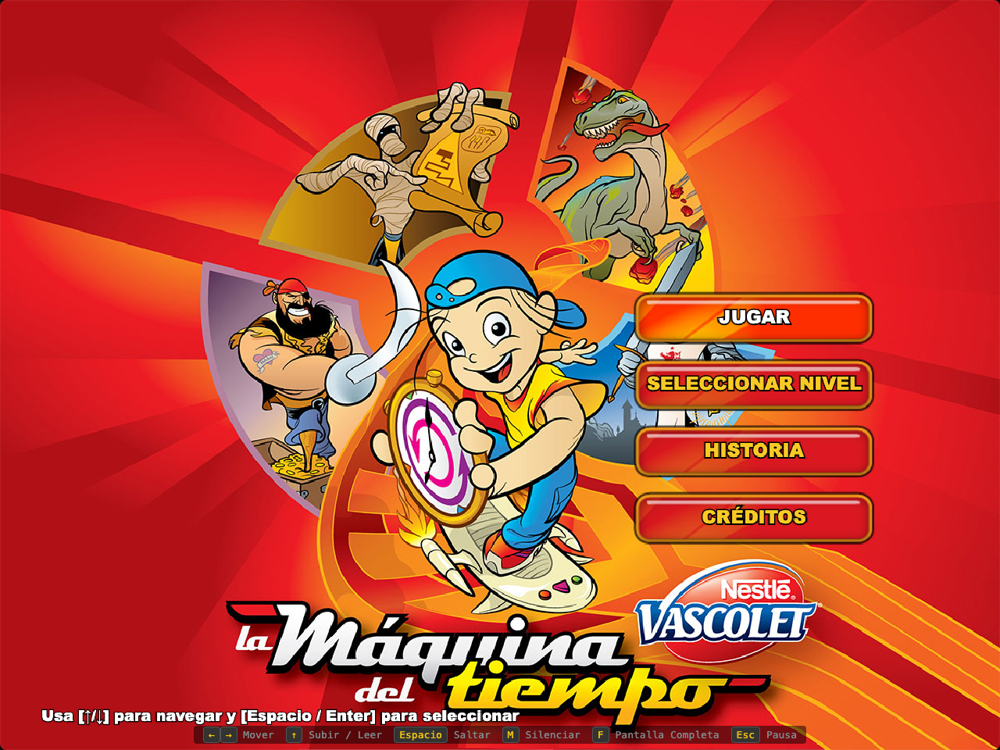
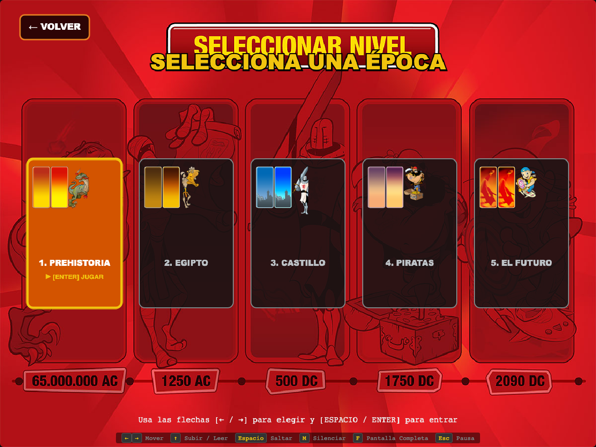
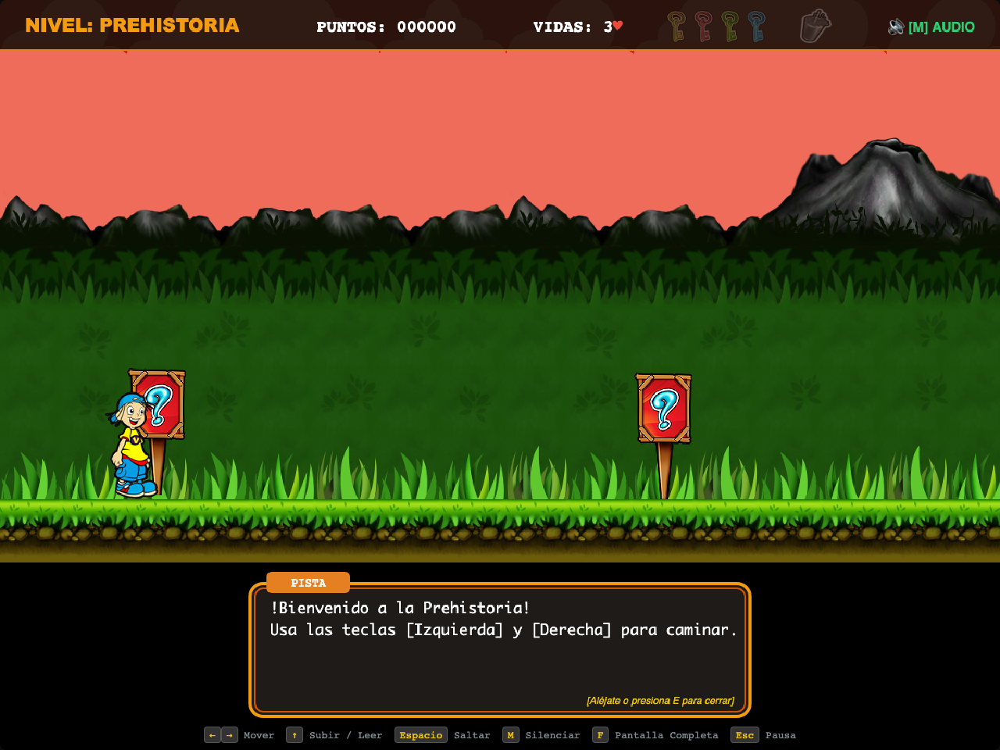
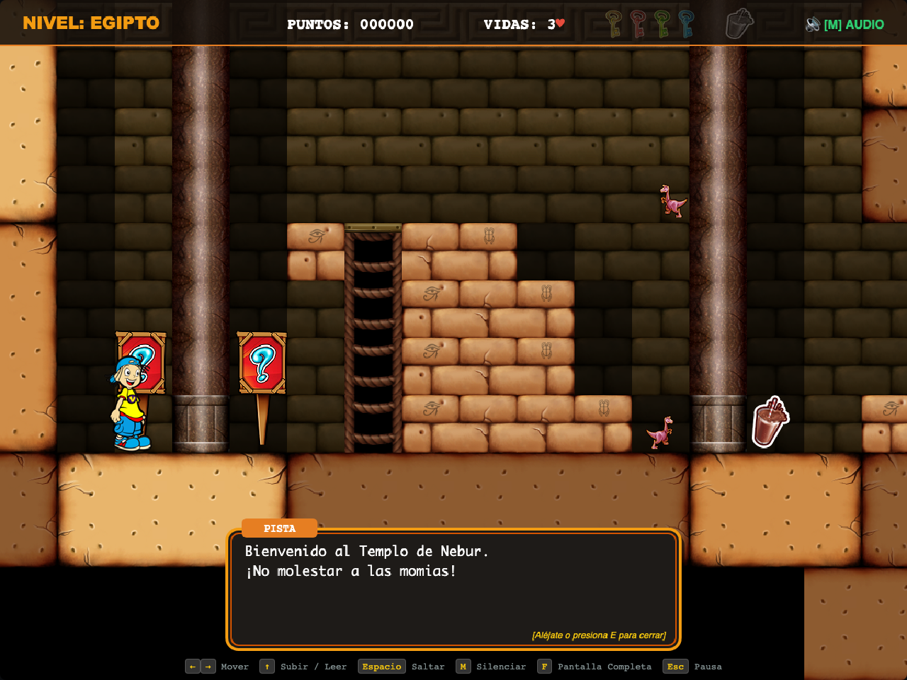
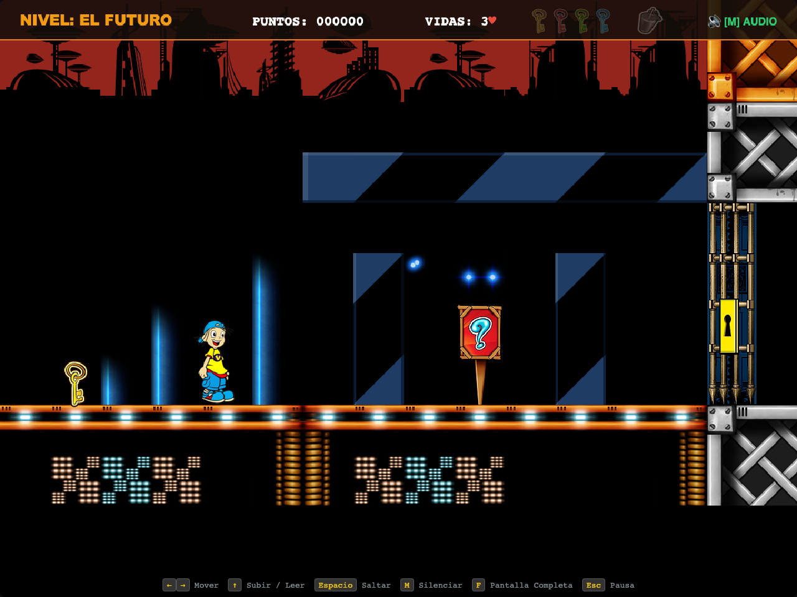
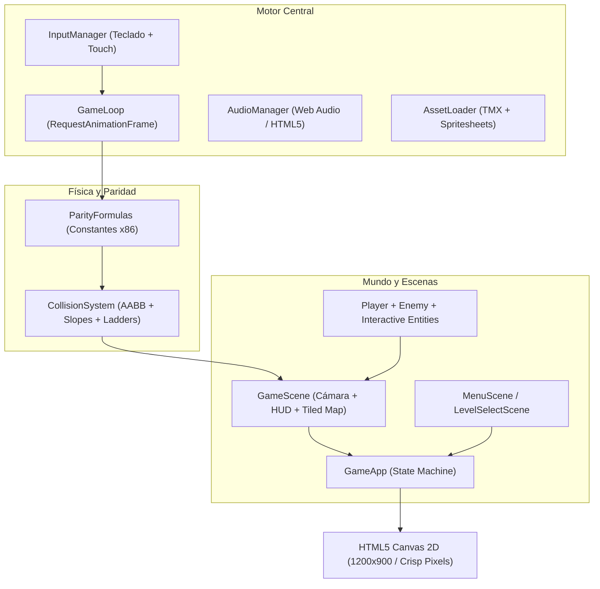

<div align="center">

# 🍫 Vascolet: La Máquina del Tiempo (Web Port)

[](https://github.com/nahueldlsl/vascolet-web/actions/workflows/ci.yml)
[](https://github.com/nahueldlsl/vascolet-web/actions)
[](https://www.typescriptlang.org/)
[](https://vitejs.dev/)
[](https://nahueldlsl.github.io/vascolet-web/)
[](LICENSE)
[]()

**Port web moderno y fiel en HTML5 Canvas y TypeScript del clásico videojuego uruguayo creado por Batoví Games Studio para Nestlé Uruguay y el Plan Ceibal.**

[🎮 Jugar en el Navegador](https://nahueldlsl.github.io/vascolet-web/) • [✨ Características](#-características-principales) • [🛠️ Arquitectura](#%EF%B8%8F-arquitectura-técnica-y-paridad) • [🚀 Instalación](#-instalación-y-desarrollo-local) • [📜 Licencia](#-licencia-y-preservación)

<br/>



</div>

---

## 📖 Acerca del Proyecto

En el año 2010, **Batoví Games Studio** junto a **Nestlé Uruguay** lanzaron *Vascolet: La Máquina del Tiempo*, un videojuego de plataformas 2D que marcó a toda una generación de niños uruguayos a través de las laptops escolares XO del **Plan Ceibal** y computadoras de escritorio.

Acompañando a Alejandro Vascolet en un viaje a través de diferentes eras para recuperar las piezas de la máquina del tiempo de su abuelo, el juego original fue distribuido como un binario nativo de Windows (`Vascolet.exe`).

Este proyecto es una **reconstrucción de código abierto en la web**, desarrollada mediante análisis e ingeniería inversa del ejecutable original de 32 bits, reimplementando su motor en **TypeScript moderno y Canvas 2D puro** con una meta estricta: **paridad matemática, visual y sonora del 100%**, ejecutable instantáneamente en cualquier navegador contemporáneo (PC, tablets y smartphones) sin emuladores externos.

---

## ✨ Características Principales

- 🎯 **Motor Canvas 2D Personalizado**: Cero dependencias de motores pesados (sin Phaser ni Pixi.js). Motor ultraligero y optimizado para 60 FPS estables.
- 🔬 **Paridad Binaria 1:1**:
  - Curvas de salto parabólicas, aceleración horizontal, fricción e inercia idénticas al binario x86 original.
  - Fórmulas de colisión AABB y resolución de penetración con plataformas, escaleras, trampas y puertas.
  - Comportamiento y timings originales para enemigos (pirañas, dinosaurios, pterodáctilos, momias, caballeros, murciélagos, estalactitas y cañones).
  - Algoritmo de transposición de coordenadas de objetos TMX fiel al desensamblado `0x0041e916`.
- 🗺️ **Las 5 Épocas Históricas Completas**:
  1. 🦖 **Prehistoria**: Selvas primigenias, dinosaurios y ríos de lava.
  2. 🏛️ **Egipto Antiguo**: Pirámides, pasajes secretos y momias guardianas.
  3. ⚔️ **Castillo Medieval**: Fortalezas de piedra, caballeros armados y fosas con púas.
  4. 🏴‍☠️ **Mundo Pirata**: Navíos, cañones y peligrosos muelles de madera.
  5. 🚀 **El Futuro**: Ciudades tecnológicas, campos de fuerza y plataformas móviles.
- 🦹 **Trajes y Habilidades Especiales**:
  - Traje clásico de Alejandro Vascolet.
  - Traje de Dinosaurio (pisada pesada y saltos potentes).
  - Patineta gravitacional futurista.
- 📱 **Soporte Multiplataforma & Responsive**:
  - Controles de teclado completos para ordenadores de escritorio.
  - Interfaz táctil virtual (Touch D-Pad y botones de acción) integrada automáticamente en pantallas táctiles y dispositivos móviles.
- 🔊 **Audio y Música Originales**:
  - Banda sonora completa y efectos de sonido originales en formato OGG.
  - Desbloqueo y gestión de audio conforme a las políticas de reproducción automática modernas.
- 🧪 **Suite de Pruebas de Regresión**: 30 pruebas unitarias en **Vitest** que validan la matemática de los enemigos, proyectiles, saltarines y carga de niveles.

---

## 📸 Galería

<div align="center">

| Selección de Nivel | Prehistoria |
|:---:|:---:|
|  |  |

| Egipto Antiguo | El Futuro |
|:---:|:---:|
|  |  |

</div>

---

## 🕹️ Controles

| Acción | Teclado (PC) | Controles Táctiles (Móvil) |
|:---|:---:|:---:|
| **Moverse a la izquierda** | <kbd>←</kbd> o <kbd>A</kbd> | Botón ◀ |
| **Moverse a la derecha** | <kbd>→</kbd> o <kbd>D</kbd> | Botón ▶ |
| **Subir escaleras / Leer letreros** | <kbd>↑</kbd> o <kbd>W</kbd> | Botón ▲ / LEER |
| **Bajar escaleras** | <kbd>↓</kbd> o <kbd>S</kbd> | Botón ▼ |
| **Saltar** | <kbd>Espacio</kbd> | Botón SALTO |
| **Pausar / Menú** | <kbd>Esc</kbd> | Botón ⏸ |
| **Silenciar Audio** | <kbd>M</kbd> | Menú de Opciones |
| **Pantalla Completa** | <kbd>F</kbd> | — |

---

## 🛠️ Arquitectura Técnica y Paridad

El proyecto fue estructurado en torno a una arquitectura modular orientada a datos y rendimiento:



### Fórmulas de Paridad Reversadas
- **Transposición de Objetos TMX**: En el motor original, los objetos del mapa se anclan usando el centro en X y la base en Y (`x = obj.x - obj.w * 0.5`, `y = obj.y - obj.h`).
- **Comportamiento del Saltarín**: Velocidad vertical inicial `vy = -850 px/s` que restablece el contador de salto para permitir alcanzar alturas exactas.
- **Resolución de Puertas con Llaves**: Manejo de bloqueo unidireccional y bidireccional evitando que el personaje atraviese límites antes de recolectar la llave correspondiente.

---

## 📂 Estructura del Repositorio

```
vascolet-web/
├── .github/
│   ├── workflows/
│   │   ├── ci.yml                 # Integración continua (Typecheck, Vitest, Build)
│   │   └── deploy.yml             # Despliegue automático a GitHub Pages
│   └── ISSUE_TEMPLATE/            # Plantillas estandarizadas para issues
├── docs/
│   └── screenshots/               # Capturas in-game en alta fidelidad
├── public/
│   └── assets/                    # Assets del juego (audio, imágenes, mapas TMX)
├── src/
│   ├── core/                      # Input, Cámara, Colisiones, Audio y Cargas
│   │   ├── AssetLoader.ts
│   │   ├── AudioManager.ts
│   │   ├── Camera.ts
│   │   ├── Collision.ts
│   │   ├── Input.ts
│   │   └── ParityFormulas.ts      # Fórmulas reversadas del ejecutable x86
│   ├── data/                      # Metadatos JSON de sprites y enemigos
│   ├── entities/                  # Entidades interactivas (Player, Enemy, Item)
│   ├── scenes/                    # Escenas de juego, menú, selector y cinemáticas
│   ├── ui/                        # HUD de vidas/puntuación y modales
│   ├── main.ts                    # Punto de entrada y loop principal
│   └── types.ts                   # Interfaces y tipos del motor
├── tests/
│   └── parity/                    # 30 pruebas automatizadas con Vitest
├── index.html                     # Contenedor HTML5 y overlay táctil
├── package.json                   # Configuración del paquete y scripts
├── tsconfig.json                  # Configuración de TypeScript
└── vite.config.ts                 # Configuración del bundler Vite
```

---

## 🚀 Instalación y Desarrollo Local

### Prerrequisitos
- [Node.js](https://nodejs.org/) (versión 18 o superior recomendada)
- [npm](https://www.npmjs.com/)

### 1. Clonar el repositorio
```bash
git clone https://github.com/nahueldlsl/vascolet-web.git
cd vascolet-web
```

### 2. Instalar dependencias
```bash
npm install
```

### 3. Iniciar el servidor local
```bash
npm run dev
```
El juego estará disponible inmediatamente en `http://localhost:3000`.

### 4. Ejecutar pruebas unitarias
```bash
npm test
```

### 5. Compilar para producción
```bash
npm run build
```
Los archivos optimizados para despliegue se generarán en la carpeta `dist/`.

---

## 🤝 Contribuciones

Las contribuciones son bienvenidas, especialmente aquellas orientadas a pulir detalles de física o añadir mejoras en accesibilidad. Por favor, revisa nuestra [Guía de Contribución](CONTRIBUTING.md) antes de enviar un Pull Request.

---

## 📜 Licencia y Preservación

- **Código Fuente**: Distribuido bajo la [Licencia MIT](LICENSE).
- **Aviso sobre Propiedad Intelectual**: Este es un proyecto recreativo de ingeniería inversa sin fines comerciales ni de lucro. *Vascolet: La Máquina del Tiempo*, sus personajes, marcas, música y recursos gráficos son propiedad intelectual de **Batoví Games Studio** y **Nestlé Uruguay S.A.** Este repositorio existe con propósitos de **preservación digital y homenaje cultural** al software uruguayo.
